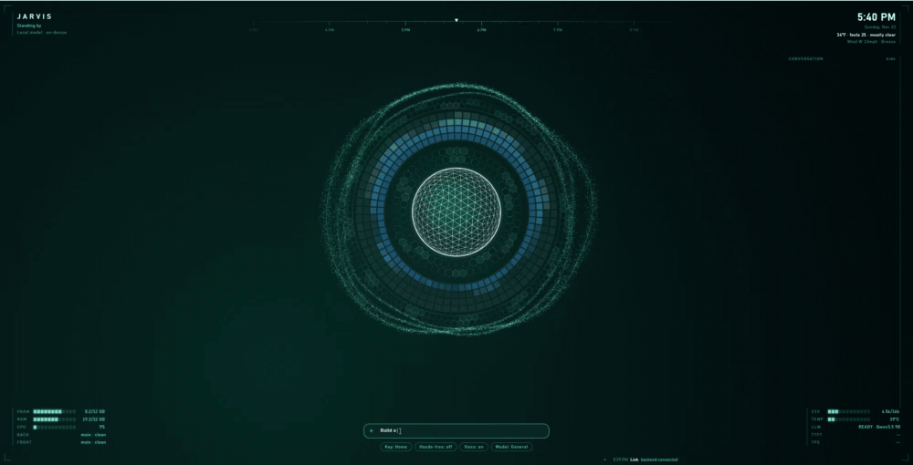
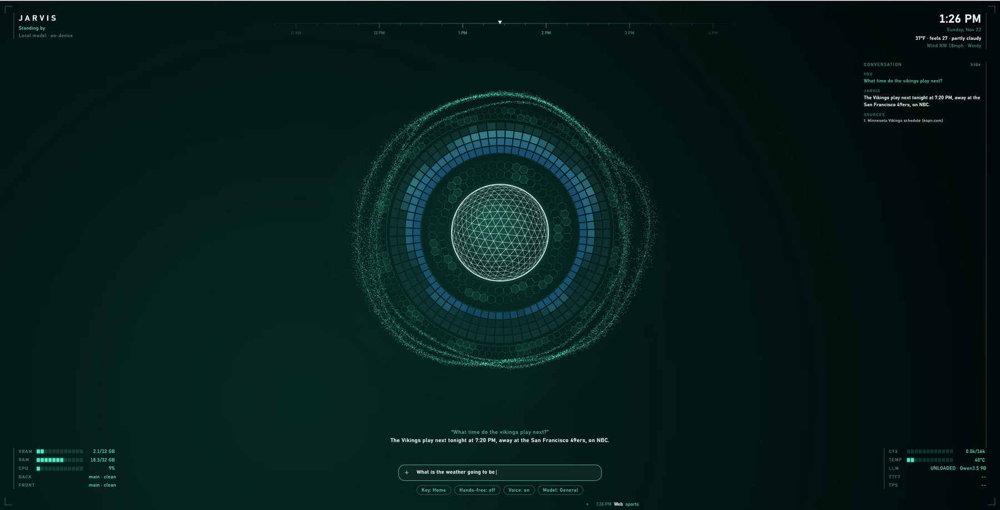
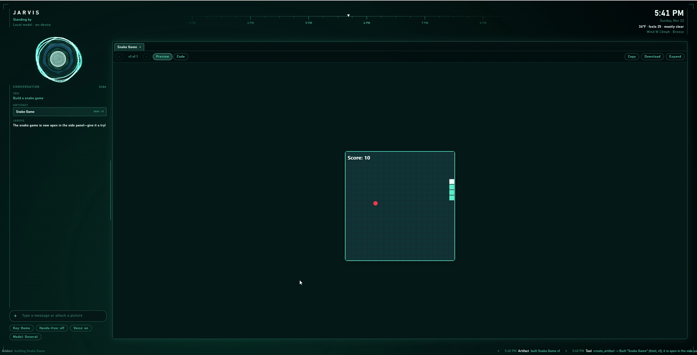
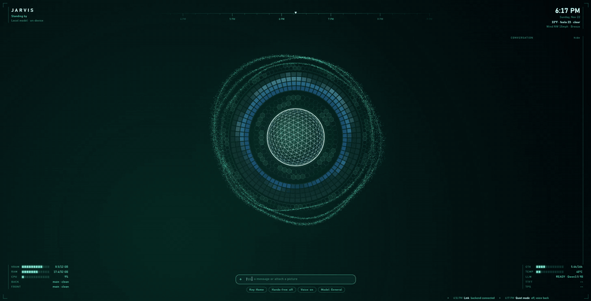
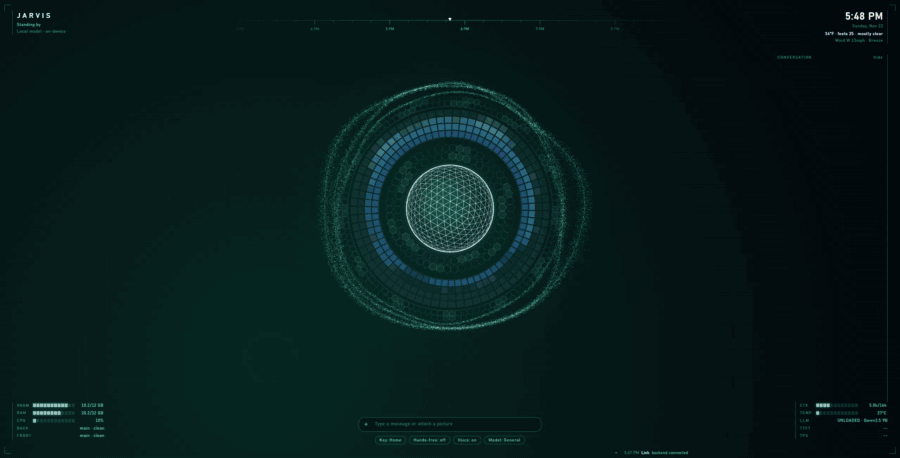
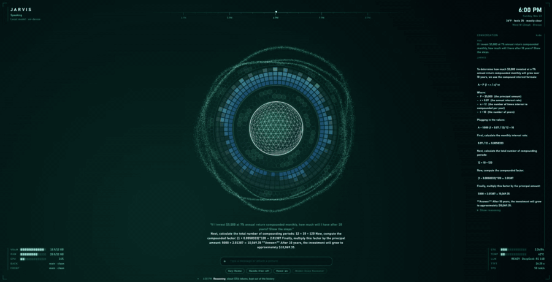
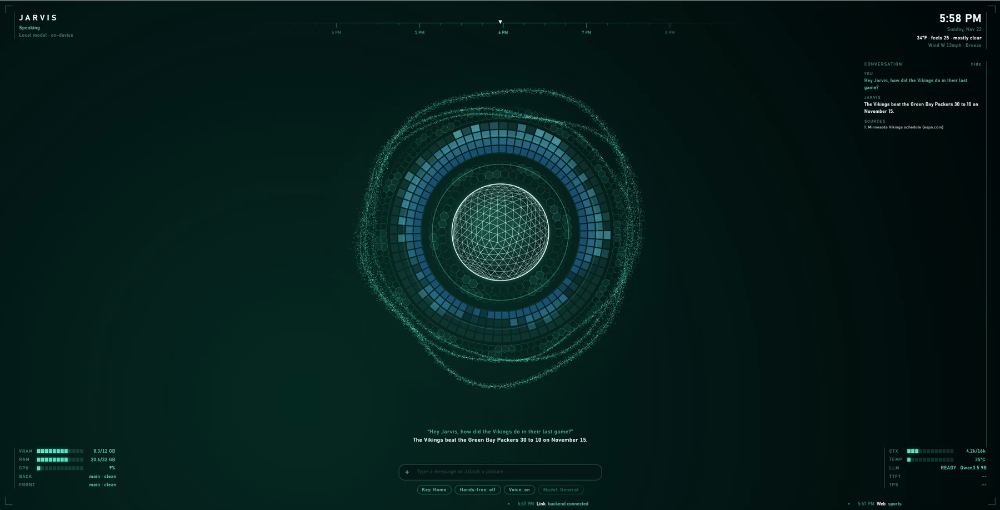
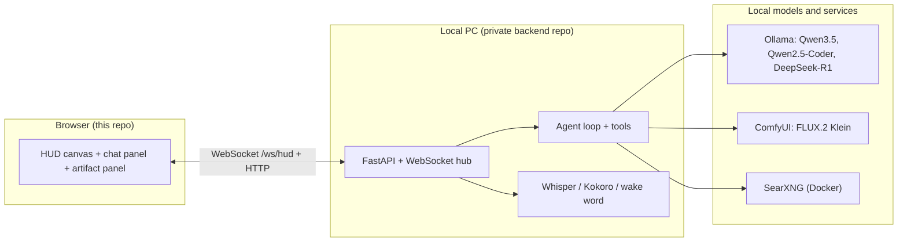

# Jarvis

> A local, offline-first AI assistant with a voice, a face, and a workbench. It runs on one gaming PC, talks back, draws pictures, builds small apps, and shows what it is doing on an animated HUD.

*"Jarvis" is a working title and the name may change.*



This repository is the **frontend**: the HUD, chat panel and artifact workbench that run in the browser. The backend that does the thinking is a separate repo and is **private for now**. Because of that, opening this page on its own shows an idle HUD. The clips below are the demo.

## What it is

Jarvis is a hobby project with a practical goal: an everyday coding and research assistant that costs nothing to run and keeps my data on my own machine. It runs on a single Windows PC with an RTX 5070 (12 GB VRAM) and uses only free, open-source models and tools.

The HUD's central core reacts to what the assistant is doing: idle, listening, thinking or speaking.



## Features

### Artifacts: apps, code and live previews
Ask for a small app and the code streams into a side panel, then runs in a sandboxed live preview. Ask for a change and the result lands as a new version of the same tab, with arrows to step between versions. If the preview throws an error, Jarvis reads it and fixes the code itself. Route maps (Leaflet, with tiles served through the backend) and charts open in the same panel.



### Charts
Give it numbers, or have it look them up, and it draws a line or bar chart (Chart.js) in the panel.



### Image generation
`/draw` a prompt, or just say "draw a lighthouse in a storm". Pictures are made locally with FLUX.2 Klein through ComfyUI. Jarvis swaps the GPU between the chat model and the image model on its own, and follow-ups like "try a castle" or "another one" reuse the loaded model. Click any picture to zoom, and Keep the ones you want.



### Coding roles
A single dropdown (or a voice command like "switch to deep reasoner") changes the model behind the chat:

| Role | Model | Used for |
| --- | --- | --- |
| General | Qwen3.5 9B | Everyday chat, tools, pictures, web |
| Fast Coder | Qwen2.5-Coder 14B | Quick code answers |
| Deep Reasoner | DeepSeek-R1-Distill 14B | Step-by-step reasoning, with a collapsible "Show reasoning" fold |

Chat history carries over when the role changes, and long code blocks go straight to the artifact panel instead of being read aloud.



### Voice
Wake word ("Hey Jarvis"), a push-to-talk hotkey and hands-free follow-ups, with Whisper for speech to text and Kokoro for speech out. Replies are cleaned up for speaking: site names instead of web addresses, no emoji, and code is never read aloud. A **quiet mode** mutes the voice while everything else keeps working.

### Web and sports lookups
Web search runs through a self-hosted SearXNG instance, and sources are shown under each reply. Sports scores come from ESPN, and fantasy football lookups use the Sleeper API. After a web lookup, the agent is only allowed to use a short list of safe tools, as a defense against prompt injection (there is a test page for it in `prototypes/`).



### Pictures in chat
Attach, paste (Ctrl+V) or drag a picture into the chat and ask about it. Qwen3.5 handles the vision, and old pictures age out of the context to keep it small.

### Calendar and notes
Add, move and delete Google Calendar events by voice, with a confirmation step before anything risky happens. Notes are saved locally.

## How it works



The backend pushes typed messages over a single WebSocket (state changes, transcript, streamed reply text, metrics, artifact chunks, image results) and the HUD draws them. The HUD sends back a small set of messages of its own, such as which artifact version is on screen. Everything that touches the network goes through one gateway with an offline switch, per-site delays and a check that every redirect lands on a public address.

## Tech stack

| Area | Tools |
| --- | --- |
| Frontend | Vanilla JavaScript modules, canvas, anime.js, Leaflet, Chart.js (all vendored, so the HUD needs no CDN) |
| Backend | Python, FastAPI, WebSocket |
| Language models | Ollama with Qwen3.5 9B, Qwen2.5-Coder 14B, DeepSeek-R1-Distill 14B |
| Image generation | ComfyUI with FLUX.2 Klein 4B |
| Speech | Whisper (speech to text), Kokoro (text to speech) |
| Search | SearXNG in Docker |
| Hardware | Windows PC, RTX 5070 with 12 GB VRAM |

Limits such as context size, picture counts and history budgets are set per VRAM tier, so the same code can run on a smaller card.

## Privacy and cost

- Chat, voice, pictures, code and image generation all run on the local machine.
- The only outbound requests are web search, map tiles and sports data, and they all pass through the gateway above, which can be switched off.
- No API keys, no subscriptions and no cloud AI services. It costs nothing to run beyond the electricity.
- Secrets, model files, databases and generated data are git-ignored and never committed.

## Running the frontend

The backend is private for now, so the HUD will load and sit idle. To look around anyway:

```bash
git clone https://github.com/<your-username>/ai-frontend.git
cd ai-frontend
python -m http.server 5500
```

Then open `http://localhost:5500`. In VS Code, the Live Server extension works too. With the backend running locally, the HUD connects to it over WebSocket automatically and comes to life.

If the backend repo goes public, this section will grow to cover setting up the models and services.

## Repo layout

```
ai-frontend/
├─ index.html          shell: canvas, HUD panels, chat panel, controls
├─ style.css           HUD layout and theme
├─ art.css             artifact panel styling
├─ prototypes/         parked experiments (alternate cores, prompt-injection test page)
├─ docs/media/         GIFs and screenshots used in this README
└─ js/
   ├─ main.js          entry: boot animation, frame loop
   ├─ core.js          canvas, palette, animated state
   ├─ data.js          shared live-data stores
   ├─ hub.js           draws the core: sphere, rings, particle shell
   ├─ instruments.js   edge HUD: time tape, ticker, brackets
   ├─ readouts.js      gauges, clock, weather, git status
   ├─ state.js         idle / listening / thinking / speaking
   ├─ ui.js            chat panel, captions, composer, role menu
   ├─ pictures.js      attach, paste and drop pictures
   ├─ link.js          WebSocket client, routes messages to modules
   ├─ art.js           artifact panel: tabs, preview, code, charts, maps
   └─ vendor/          anime.js, Leaflet, Chart.js
```

## Roadmap

- [x] Live HUD driven by the backend over WebSocket
- [x] Voice in and out, wake word, push-to-talk, quiet mode
- [x] Artifact panel with live preview, versions, charts and route maps
- [x] Local image generation and pictures in chat
- [x] Coding roles with model switching
- [ ] Markdown rendering in the chat panel
- [ ] Preview for non-HTML code (running it and showing the output)
- [ ] Hand gestures
- [ ] Alternate core designs and a second personality with its own look and voice
- [ ] A new name
